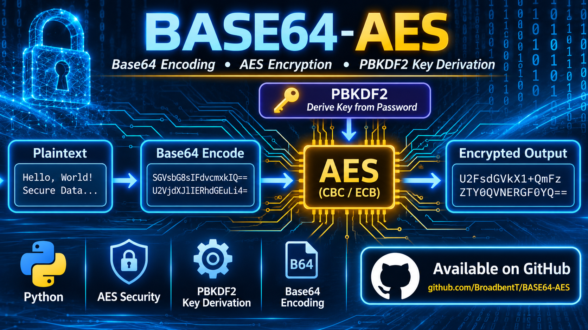
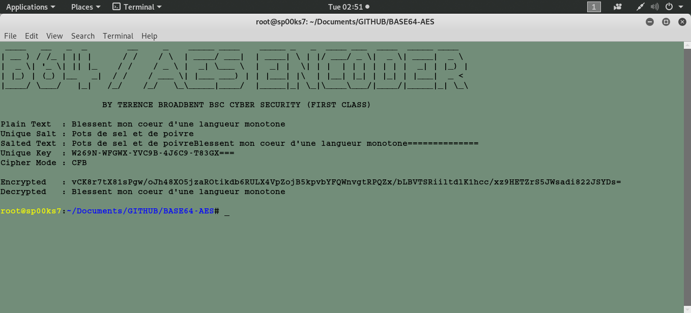

# BASE64 / AES ENCODER

### Python scripts for encoding and decoding Base64/AES text strings using Password-Based Key Derivation Function 2 (PBKDF2).

These Python scripts provide Base64 encoding and decoding alongside AES encryption and decryption, using PBKDF2 to derive cryptographic keys from user-supplied passwords.

<p align="center">
  
</p>

## Usage

Run the relevant Python script from the command line:

```bash
python base64-aes_xxx.py
```

## Available Scripts

| Language | Filename | MD5 Hash | Confidentiality Mode |
|:---|:---|:---|:---|
| Python | `base64-aes_cbc.py` | `f25752e95d5e3ce64d5d627616299246` | CBC |
| Python | `base64-aes_ecb.py` | `e655173931b11bc605b04663d63f79a6` | ECB |

- [x] For further information on block cipher confidentiality modes, see the [NIST Block Cipher Techniques](https://csrc.nist.gov/Projects/Block-Cipher-Techniques/BCM) reference.

---

## Password-Based Key Derivation Function 2 (PBKDF2)

**PBKDF2 (Password-Based Key Derivation Function 2)** is a cryptographic key derivation function designed to derive secure keys from passwords.

It uses a salt and an adjustable computational cost (iteration count) to make password-guessing and brute-force attacks more expensive.

PBKDF2 is part of the RSA Laboratories Public-Key Cryptography Standards (PKCS) series, specifically PKCS #5. It was originally specified in RFC 2898 and subsequently updated in RFC 8018 (PKCS #5 v2.1), published in 2017.

PBKDF2 supports the derivation of cryptographic keys of different lengths and is commonly used in password-based encryption systems.

Further information:

- [RFC 8018 – PKCS #5 v2.1](https://datatracker.ietf.org/doc/html/rfc8018)
- [RFC 2898 – PKCS #5](https://datatracker.ietf.org/doc/html/rfc2898)

---

## AES Confidentiality Modes

The Advanced Encryption Standard (AES) is a symmetric block cipher. Different operating modes define how AES processes data beyond a single block.

The following sections describe the confidentiality modes relevant to block cipher encryption.

### Cipher Block Chaining (CBC)

**Cipher Block Chaining (CBC)** is a confidentiality mode in which each plaintext block is combined with the previous ciphertext block before encryption.

The first plaintext block is combined with an Initialization Vector (IV).

Key characteristics:

- Requires an IV for encryption.
- The IV does not need to be secret, but must be unpredictable.
- IV integrity should be protected.
- Requires padding when plaintext is not an exact multiple of the block size.
- Encryption is inherently serial, limiting parallel processing.
- Ciphertext is malleable and CBC alone does not provide authentication.
- Susceptible to padding-oracle attacks when incorrectly implemented.
- Can be used as a building block for CBC-MAC authentication schemes.

CBC must be combined with an appropriate authentication mechanism when used in applications requiring both confidentiality and integrity.

### Electronic Codebook (ECB)

**Electronic Codebook (ECB)** is the simplest AES operating mode. Each plaintext block is encrypted independently using the same key.

Key characteristics:

- Each block is encrypted independently.
- Identical plaintext blocks produce identical ciphertext blocks under the same key.
- Does not require an IV.
- Allows parallel encryption and decryption.
- Reveals patterns in the original plaintext.
- Does not provide authentication or integrity protection.

ECB has historical and legacy applications but is unsuitable for general-purpose data encryption. It should not be used to protect ordinary messages or files.

### Cipher Feedback (CFB)

**Cipher Feedback (CFB)** is an IV-based mode that turns a block cipher into a self-synchronising stream-like encryption scheme.

Key characteristics:

- Requires an IV that must be unpredictable.
- Supports processing data in segments smaller than the AES block size.
- Encryption is inherently serial.
- Ciphertext is malleable.
- Does not provide authentication or integrity protection.
- Provides a self-synchronisation property following certain insertions or deletions in the ciphertext.

CFB is primarily of historical and specialist interest, with CTR and authenticated encryption modes generally offering more practical advantages.

### Counter Mode (CTR)

**Counter Mode (CTR)** converts a block cipher into a stream cipher by encrypting successive counter values and combining the resulting output with the plaintext.

Key characteristics:

- Uses a unique nonce/counter combination for each encryption under a given key.
- Supports parallel encryption and decryption.
- Does not require padding.
- Provides high performance in many applications.
- Reusing a nonce with the same key can completely compromise confidentiality.
- Ciphertext is malleable.
- Does not provide authentication or integrity protection.

CTR is widely used as a building block for authenticated encryption schemes.

### Output Feedback (OFB)

**Output Feedback (OFB)** is an IV-based mode that repeatedly encrypts an internal feedback value to generate a keystream.

The keystream is combined with the plaintext to produce ciphertext.

Key characteristics:

- Requires a unique IV for each encryption under the same key.
- Does not require padding.
- Supports encryption of data of arbitrary bit lengths.
- Encryption and decryption are inherently serial.
- Ciphertext is malleable.
- Does not provide authentication or integrity protection.

OFB has specialist and legacy applications, although CTR generally offers greater flexibility and performance.

### XTS-AES

**XTS-AES** is a specialised confidentiality mode designed for encrypting data stored on block-oriented storage devices.

It uses a tweakable block cipher construction to encrypt individual data units.

Key characteristics:

- Designed specifically for storage-device encryption.
- Uses a tweak derived from the data-unit address.
- Supports data units whose lengths are not exact multiples of the AES block size.
- Does not provide authentication or integrity protection.
- Is not intended for general-purpose message encryption.

XTS-AES is specified for storage applications and should not be used as a general-purpose encryption mode.

---

## Console Display

The following screenshot illustrates the program's console interface.



---

## Security Considerations

The scripts demonstrate two AES confidentiality modes:

- **CBC:** Requires a correctly generated unpredictable IV and should be combined with authentication to protect ciphertext integrity.
- **ECB:** Does not conceal repeated plaintext patterns and should not be used for general-purpose encryption.

Neither CBC nor ECB provides authenticated encryption on its own.

For new applications, an authenticated encryption mode such as AES-GCM is generally preferable because it provides both confidentiality and integrity.

PBKDF2 should also be configured with an appropriate salt, iteration count and derived-key length.

---

## Further Reading and References

- [NIST – Block Cipher Techniques](https://csrc.nist.gov/Projects/Block-Cipher-Techniques/BCM)
- [NIST SP 800-38A – Recommendation for Block Cipher Modes of Operation](https://nvlpubs.nist.gov/nistpubs/Legacy/SP/nistspecialpublication800-38a.pdf)
- [RFC 8018 – PKCS #5 v2.1](https://datatracker.ietf.org/doc/html/rfc8018)
- [RFC 2898 – PKCS #5](https://datatracker.ietf.org/doc/html/rfc2898)

**Project Repository:** [BroadbentT / BASE64-AES](https://github.com/BroadbentT/BASE64-AES)
